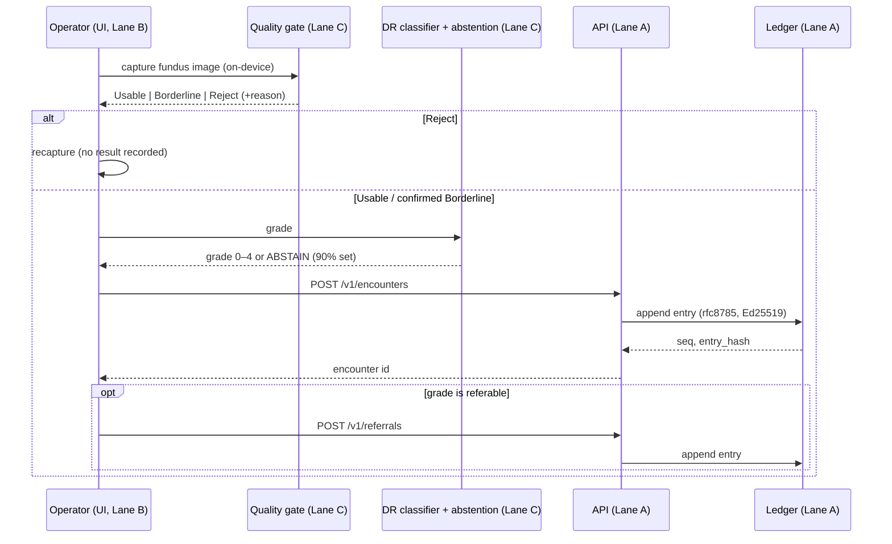

# NetraTrust — Architecture

> **Source of truth:** `SPEC.md` (frozen 2026-10-27), `CLAUDE.md`, `requirements.txt`.
> The API table in `SPEC.md` is **frozen**; nothing below may contradict it. Facts not
> in those files are marked **TBD — verify**.

## Table of contents
1. [Tech stack (pinned)](#1-tech-stack-pinned)
2. [Folder structure](#2-folder-structure)
3. [Database](#3-database)
4. [API flow](#4-api-flow)
5. [Referral state machine](#5-referral-state-machine)
6. [Encounter sequence](#6-encounter-sequence)
7. [Deployment](#7-deployment)

## 1. Tech stack (pinned)
Versions are frozen in `requirements.txt`; do not bump. Python **3.12+**.

| Layer | Component | Version |
|---|---|---|
| ML | torch / torchvision | 2.14.1 / 0.29.1 |
| ML | timm | 1.0.30 |
| ML | scikit-learn | 1.9.1 |
| Uncertainty | mapie | 1.6.0 |
| API | fastapi / starlette | 0.162.0 / 1.6.0 |
| API | pydantic | 2.14.1 |
| API | uvicorn | 0.54.0 |
| DB | sqlmodel / sqlalchemy | 0.0.48 / 2.1.6 |
| Integrity | cryptography | 50.0.2 |
| Integrity | rfc8785 | 0.1.4 |
| UI | streamlit | 1.66.1 |
| UI | plotly | 7.1.0 |
| Explain | grad-cam | 1.5.7 |

**Models:** quality gate = QuickQual (frozen `densenet121.tv_in1k` @512px + SVM),
fallback QuickQual-MEME; DR backbone = `convnext_tiny.in12k_ft_in1k` @512px;
preprocessing = background removal + resize only.

## 2. Folder structure
```
netratrust/
├── SPEC.md                 # frozen contract
├── CLAUDE.md               # conventions
├── requirements.txt        # pinned deps
├── config/thresholds.yaml  # fitted on calibration split only
├── data/splits/            # frozen, committed, patient-level
├── netra/
│   ├── api/                # Lane A — FastAPI app, routes
│   ├── ledger/             # Lane A — hash chain, Ed25519, verify
│   ├── db/                 # Lane A — SQLModel tables, triggers
│   ├── ui/                 # Lane B — Streamlit app
│   ├── models/             # Lane C — quality gate, DR classifier
│   └── eval/               # Lane C — metrics.py (single source)
├── notebooks/              # Lane C — training (Kaggle/T4)
├── scripts/                # make_splits.py, gen_device_key.py
└── tests/
```

## 3. Database
SQLite, accessed through SQLModel. Seven tables. Ledger-bearing tables are append-only,
enforced by triggers that raise on UPDATE/DELETE.

- **sites** — id, name, region, created_at (strings for IDs/timestamps).
- **devices** — kid, site_id, ed25519_pub (hex), registered_at.
- **encounters** — id, site_id, device_kid, quality_verdict
  (usable|borderline|reject), dr_grade (nullable when rejected/abstained),
  abstained (bool), prediction_set (JSON of ints), model_version, created_at.
- **referrals** — id, encounter_id, state, created_at (transitions logged separately).
- **referral_events** — id, referral_id, from_state, to_state, attempt_n, channel,
  reason, created_at.
- **ledger** — seq (int ≤ 2^53), entry_hash (hex), prev_hash (hex), payload (canonical
  JSON, **no floats**), signer_kid, signature (hex), created_at (string).
- **checkpoints** — seq, root_hash, signer_kid, signature, created_at.

**Hash chain:** `entry_hash = SHA-256(prev_hash || rfc8785(payload))`. Each entry's
32-byte hash is signed with the device's Ed25519 key. A signed checkpoint attests the
latest `seq` and hash (no Merkle tree — a running chain is sufficient at this scale).

## 4. API flow
The nine frozen endpoints (shapes in `SPEC.md`):

| Method | Path | Purpose |
|---|---|---|
| POST | `/v1/encounters` | record an encounter + decision; append to ledger |
| POST | `/v1/referrals` | issue a referral for a referable grade |
| PATCH | `/v1/referrals/{id}` | advance referral state; append event to ledger |
| GET | `/v1/ledger/verify` | re-walk chain, recompute hashes, check signatures |
| GET | `/v1/ledger/checkpoint` | latest signed checkpoint |
| GET | `/v1/sites/{id}/status` | gradability, abstention, drift flag |
| POST | `/v1/sites/{id}/audit` | record model-version audit result |
| GET | `/v1/metrics/sites` | per-site distributions (Wilson intervals) |
| GET | `/v1/queue/depth` | pending sync count |

Conventions (from `CLAUDE.md`): handlers are **sync `def`** (SQLite is blocking);
use a `lifespan=` context manager; every decision is appended to the ledger **before**
the response is returned. Sync is at-least-once with server-side dedup on an
Idempotency-Key header.

## 5. Referral state machine
```
issued
  → contact_attempted (attempt_n, channel)   [repeatable]
  → contacted
  → appointment_offered
  → examined        (terminal, success)
  | abandoned(reason)   (terminal, from any non-terminal state)
```
Every transition writes a `referral_events` row and a ledger entry.

## 6. Encounter sequence


## 7. Deployment
- **Fly.io**, 256 MB instance + 1 GB persistent volume (SQLite lives on the volume),
  auto-stop off. ≈ $2.34/mo. **TBD — verify** current pricing.
- Render free tier is unusable here: **no persistent disk**, so the ledger would reset.
- Per-device Ed25519 keypairs replace mTLS (`scripts/gen_device_key.py`); private keys
  stay in `keys/` (gitignored).
